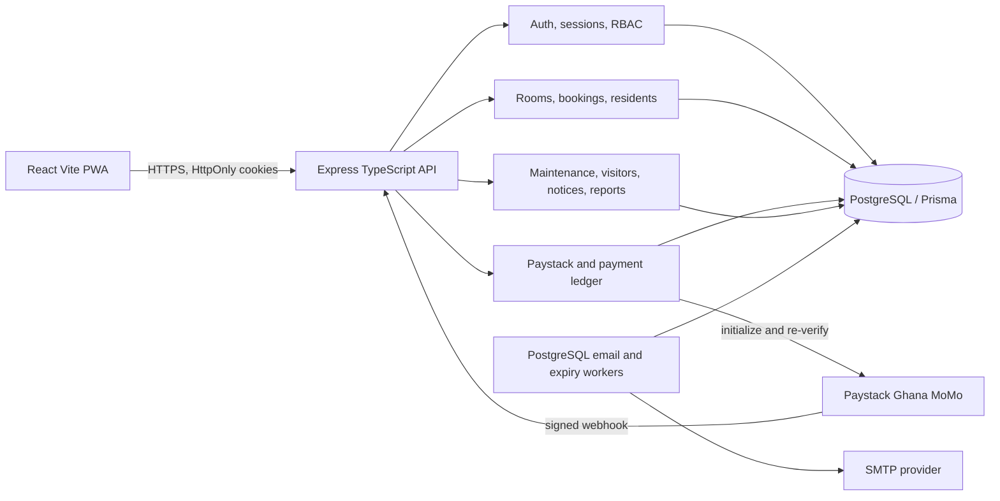
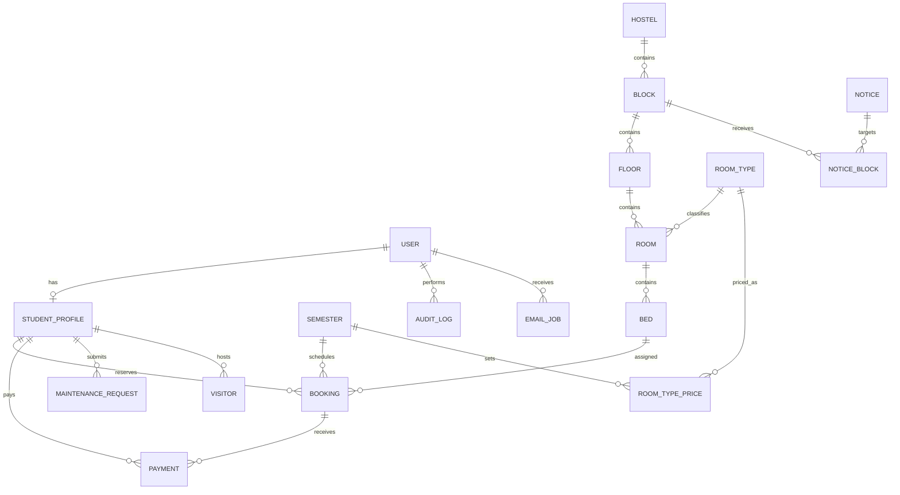

# Hostel Management Architecture

## Phase 1: Scope and assumptions

This MVP supports resident self-service, staff operations, and administrator/manager control for a Ghanaian student hostel. It includes semester-based pricing and bookings, mobile-money payments, room inventory, check-in/out, maintenance, visitors, notices, audits, reporting, and email delivery.

Assumptions:

- Prices are per student per semester: 1-in-room GHS 20,000; 2-in-room GHS 10,000; 4-in-room GHS 3,000; 8-in-room GHS 2,000.
- The initial deposit is 50%; an administrator can configure the deposit basis points per semester.
- Blocks are separated by male/female resident gender, with mixed blocks available. Gender is used only for accommodation assignment.
- A selected bed is held for 30 minutes. The reservation is confirmed after the initial deposit is verified.
- Manual refunds and booking cancellation are recorded for staff follow-up; no card or bank payment flow is offered.
- A staff secretary is created by the administrator and must change the temporary password at first sign-in.

Risks and controls:

- Live Paystack, SMTP, and PostgreSQL credentials are deployment prerequisites; payment and mail integrations remain disabled until configured.
- Booking assignment locks the student and candidate bed inside a serializable PostgreSQL transaction. Partial unique indexes provide a second database-level guard.
- The current legacy Express/Supabase server remains in `src/server.js`; the new TypeScript API is `src/v1/server.ts` and requires a PostgreSQL `DATABASE_URL` plus Prisma migration. Do not point one schema at the other or assume old accounts have migrated.
- This implementation is an MVP, not a legal compliance certification. Before production, complete a Ghana Data Protection Act review, threat model, key rotation plan, provider certification, restore drill, accessibility review, and load/security testing.

## Phase 2: Architecture





Folder layout:

```text
web/src/                 React application and role portals
server/prisma/           PostgreSQL schema, seed, and constraints
server/src/v1/routes/    Versioned REST route modules
server/src/v1/services/  Auth support, audit, receipts, durable workers
server/src/v1/middleware/Authentication, RBAC, validation errors
server/scripts/          Migration helpers and maintenance scripts
docs/                    Architecture, API contract, and role guides
```